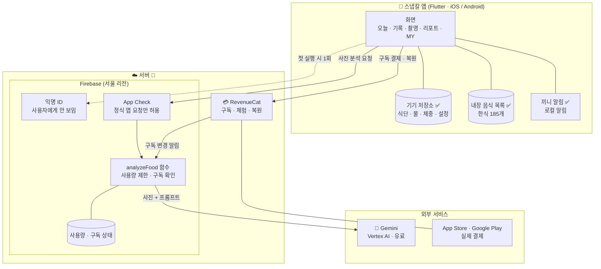
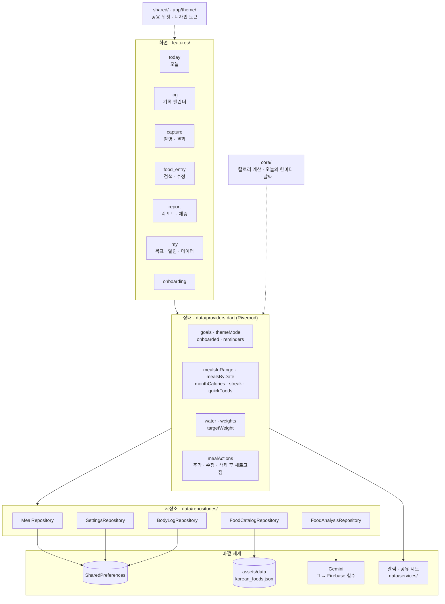
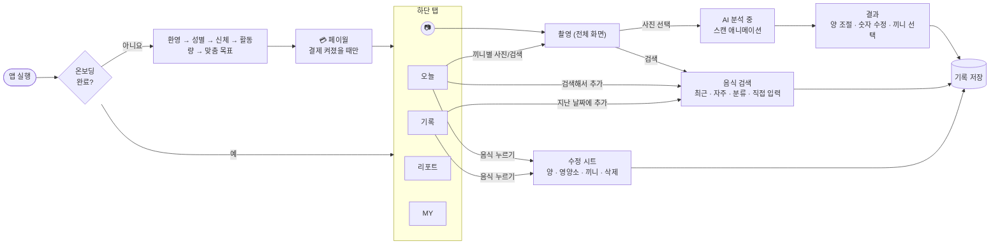
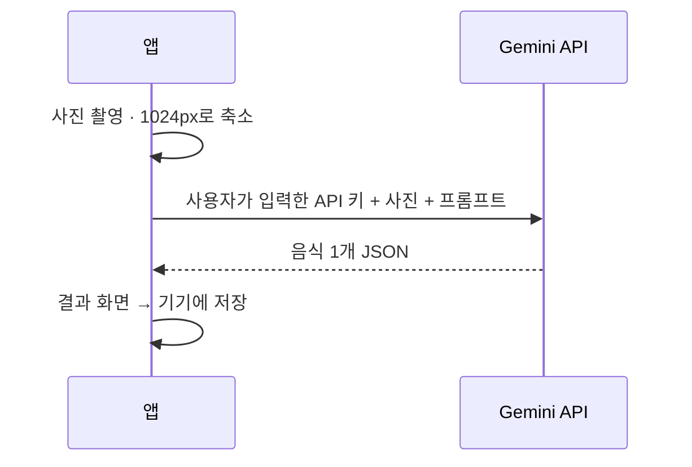
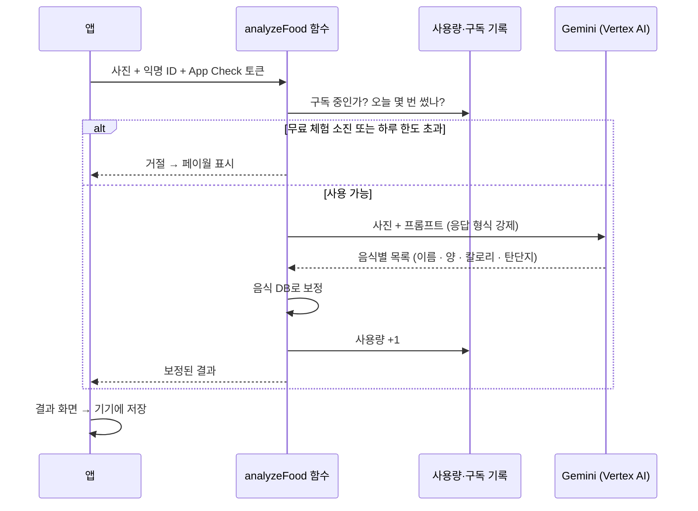
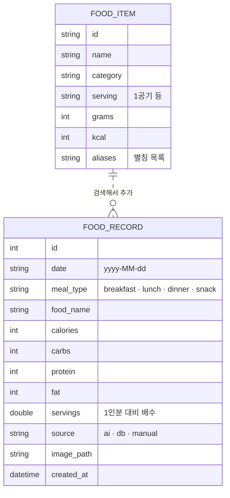
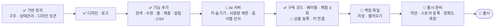

# 스냅칼 구조도

> 2026-11-10 기준 · 코드: `lib/` · 기획: [PRODUCT_DESIGN.md](PRODUCT_DESIGN.md)
>
> **범례**: ✅ 구현됨 · 🚧 다음 작업 · 💤 나중에

---

## 1. 전체 구성 (출시 목표)

로그인 화면은 없습니다. 식단 기록은 **폰에만** 저장하고, 서버는 AI 분석과 구독 확인에만 씁니다.

| 구성 요소 | 하는 일 | 상태 |
|---|---|---|
| 기기 저장소 | 식단 기록, 물, 체중, 목표, 알림 설정 | ✅ |
| 내장 음식 목록 | 검색해서 기록하기 (초성 검색 지원) | ✅ 식약처 DB로 교체 예정 |
| 끼니 알림 | 아침·점심·저녁 기록 알림 (서버 없이 폰에서) | ✅ |
| Gemini 호출 | **현재는 앱이 사용자 API 키로 직접 호출** | 🚧 서버로 이동 |
| Firebase 익명 ID | 서버가 사용량을 세기 위한 보이지 않는 ID | 🚧 |
| RevenueCat | 구독 결제, 체험, 복원 | ✅ 앱 코드 완료 (결제 꺼짐으로 대기) → [BILLING.md](BILLING.md) |
| 백업 파일 | 폰 교체 시 기록 옮기기 (로그인 대신) | 🚧 |

---

## 2. 앱 내부 계층

화면은 저장소(Repository) **인터페이스만** 봅니다. 그래서 Gemini 직접 호출을 서버 호출로 바꿔도 화면 코드는 바뀌지 않습니다.

### 폴더 지도

| 폴더 | 내용 |
|---|---|
| `lib/app/` | 앱 시작점, 화면 이동(`router.dart`), 디자인 토큰(`theme/`) |
| `lib/core/` | 화면과 무관한 순수 로직: 끼니 판별, TDEE 계산, 오늘의 한마디, 날짜 키 |
| `lib/data/models/` | `FoodRecord`(기록), `FoodItem`(음식 목록), `AnalysisResult`(AI 결과) |
| `lib/data/repositories/` | 저장·조회 인터페이스와 구현 |
| `lib/data/services/` | 끼니 알림 예약, CSV 내보내기 |
| `lib/data/billing/` | 구독 결제 (결제 꺼짐 / 가짜 / RevenueCat), 이용 범위, 무료 분석 횟수 |
| `lib/features/paywall/` | 페이월, 잠금 확인 함수, 잠금 표시, MY 구독 카드 |
| `lib/features/` | 화면별 폴더 |
| `lib/shared/` | 여러 화면이 같이 쓰는 위젯 (칼로리 링, 끼니 카드, 입력 대화상자 등) |
| `assets/brand/` | 로고·아이콘 원본 (`mark_source.js`가 좌표 원본) |
| `test/` | 로직·저장소·화면 흐름 테스트, 디자인 검수용 스크린샷 |

---

## 3. 화면 흐름

---

## 4. 사진 분석 흐름

### 지금 (출시 불가 상태)

### 바꿀 구조 🚧

- API 키는 서버에만 있고 앱에는 없습니다.
- 사진은 분석에만 쓰고 서버에 저장하지 않습니다.
- 무료 사용자는 체험 3회, 프리미엄은 하루 30회까지입니다.

---

## 5. 기기에 저장되는 데이터

모두 `SharedPreferences`에 저장합니다. 키 이름은 이전 버전과 같아서 업데이트해도 기록이 유지됩니다.

| 키 | 형식 | 내용 |
|---|---|---|
| `food_records` | JSON 배열 | 식단 기록 (`FoodRecord`: 날짜, 끼니, 음식, 칼로리·탄단지, 인분, 출처, 사진 경로) |
| `daily_goal`, `carbs_goal`, `protein_goal`, `fat_goal` | 정수 | 하루 목표 |
| `water_log` | JSON 객체 | 날짜 → 마신 물(ml) |
| `water_goal` | 정수 | 물 목표 (기본 2,000ml) |
| `weight_log` | JSON 객체 | 날짜 → 체중(kg) |
| `target_weight` | 실수 | 목표 체중 |
| `meal_reminders` | JSON 배열 | 끼니 알림 (켜짐, 시각) |
| `theme_mode` | 문자열 | 시스템 / 라이트 / 다크 |
| `onboarded` | 참/거짓 | 온보딩 완료 여부 |
| `gemini_api_key` | 문자열 | 🚧 서버 전환 후 삭제 |

---

## 6. 출시까지 남은 단계

| 단계 | 필요한 것 (직접 준비) |
|---|---|
| AI 서버 | Firebase 프로젝트 + 결제 수단, `firebase login` |
| 구독 | Apple 개발자 계정($99/년), Google Play 개발자 계정($25), RevenueCat 계정 |
| 출시 준비 | 사업자등록, 개인정보처리방침 게시용 웹 주소 |
