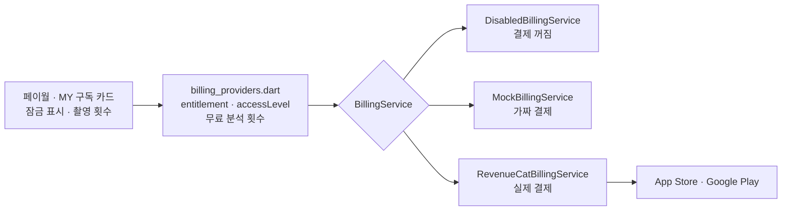

# 구독 결제 켜는 방법

결제는 **기본으로 켜져 있습니다.**

| 빌드 | 옵션 없이 빌드하면 |
|---|---|
| 개발 빌드 (`flutter run`) | **가짜 결제**: 무료 3회 제한, 페이월, 체험·구독·복원이 실제 돈 없이 동작. MY에 "구독·무료 횟수 초기화" 버튼 |
| 출시 빌드 (`--release`) | RevenueCat 키가 있으면 **실제 결제**, 없으면 꺼짐(모든 기능 무료). 가짜 결제는 출시 빌드에서 쓰지 않음 |

직접 고르려면 `--dart-define=BILLING=off | mock | revenuecat`.

| 모드 | 동작 |
|---|---|
| `off` | 모든 기능 무료. 페이월은 "출시 준비 중" 미리보기 |
| `mock` | 가짜 결제 (개발 빌드 기본값) |
| `revenuecat` | RevenueCat으로 App Store / Google Play 결제 (키 필요) |

```bash
# 개발: 옵션 없이 실행하면 가짜 결제 + 테스트 광고
flutter run

# 결제를 끄고(모두 무료) 실행
flutter run --dart-define=BILLING=off

# 실제 결제
flutter run --dart-define=BILLING=revenuecat \
  --dart-define=RC_IOS_KEY=appl_xxxxxxxx \
  --dart-define=RC_ANDROID_KEY=goog_xxxxxxxx \
  --dart-define=TERMS_URL=https://... \
  --dart-define=PRIVACY_URL=https://...
```

---

## 실제 결제 준비 (순서대로)

### 1. 스토어에 구독 상품 만들기 🙋
사업자등록 + 통신판매업 신고, 개발자 계정, 정산 계좌가 먼저 필요합니다 ([TODO.md](TODO.md)).

| 상품 ID | 가격 | 체험 | 구독 그룹 |
|---|---|---|---|
| `caloriesnap_premium_yearly` | ₩39,000 / 년 | 7일 무료 (Introductory Offer) | 칼로리스냅 프리미엄 |
| `caloriesnap_premium_monthly` | ₩5,900 / 월 | 없음 | 칼로리스냅 프리미엄 |

- App Store Connect: 앱 → 구독 → 구독 그룹 만들기 → 두 상품 추가
- Google Play Console: 수익 창출 → 구독 → 두 상품 + 기본 요금제 (연간에 7일 무료 체험 혜택)

### 2. RevenueCat 설정 🙋
1. RevenueCat 가입 → 프로젝트 만들기 → iOS 앱, Android 앱 연결 (App Store Connect API 키, Google 서비스 계정)
2. **Entitlement**: `premium` (정확히 이 이름)
3. **Products**: 위 두 상품을 불러와서 `premium`에 연결
4. **Offering**: `default`를 현재(current)로 두고 패키지 2개
   - `$rc_annual` → `caloriesnap_premium_yearly`
   - `$rc_monthly` → `caloriesnap_premium_monthly`
5. **API Keys**에서 iOS(`appl_`), Android(`goog_`) 공개 키 복사 → 위 빌드 옵션에 넣기

### 3. 샌드박스 테스트 🙋🤖
- iOS: 설정 → App Store → 샌드박스 계정으로 로그인 후 체험 → 결제 → 해지 → 만료 확인 (샌드박스에서는 1년이 1시간)
- Android: Play Console 라이선스 테스터에 본인 계정 추가 후 내부 테스트 트랙으로 설치

### 4. 서버 연결 (AI 서버 단계에서) 🤖
- RevenueCat 웹훅 → Firebase 함수 → 구독 상태 저장
- 무료 체험 횟수를 서버에서 세도록 변경 (지금은 기기에서 셈)

---

## 코드 구조



| 파일 | 내용 |
|---|---|
| `lib/app/config.dart` | 빌드 옵션 (`BILLING`, RevenueCat 키, 약관 주소) |
| `lib/data/billing/billing_models.dart` | 결제 모드, 상품, 구독 상태, 프리미엄 기능 목록, 무료 체험 횟수(3회) |
| `lib/data/billing/billing_service.dart` | 인터페이스, 결제 꺼짐·가짜 결제 구현, 설계서 가격 |
| `lib/data/billing/revenuecat_billing_service.dart` | RevenueCat 구현 |
| `lib/data/billing/billing_providers.dart` | 구독 상태, 이용 범위(열림/무료/프리미엄), 무료 분석 횟수 |
| `lib/features/paywall/` | 페이월 화면, 잠금 확인 함수(`ensurePremium`, `ensureAnalysisQuota`), 잠금 표시(`PremiumLock`), MY 구독 카드 |

### 프리미엄 잠금 지점

| 기능 | 무료 | 프리미엄 | 위치 |
|---|---|---|---|
| AI 사진 분석 | 평생 3회 → 이후엔 사진만 찍고 검색·직접 입력으로 기록 (항상 무료) | 무제한 | 촬영 버튼 누를 때. 페이월에 "AI 없이 사진과 함께 직접 기록하기" 버튼 |
| 체중 추이 그래프 | 흐리게 + "프리미엄으로 보기" | 열림 | 리포트 |
| 식단 기록 내보내기 (CSV) | 페이월 | 열림 | MY |

잠금 지점을 늘리려면 `PremiumFeature`에 항목을 추가하고, 버튼에서는 `ensurePremium()`, 화면 일부는 `PremiumLock`으로 감싸면 됩니다.
