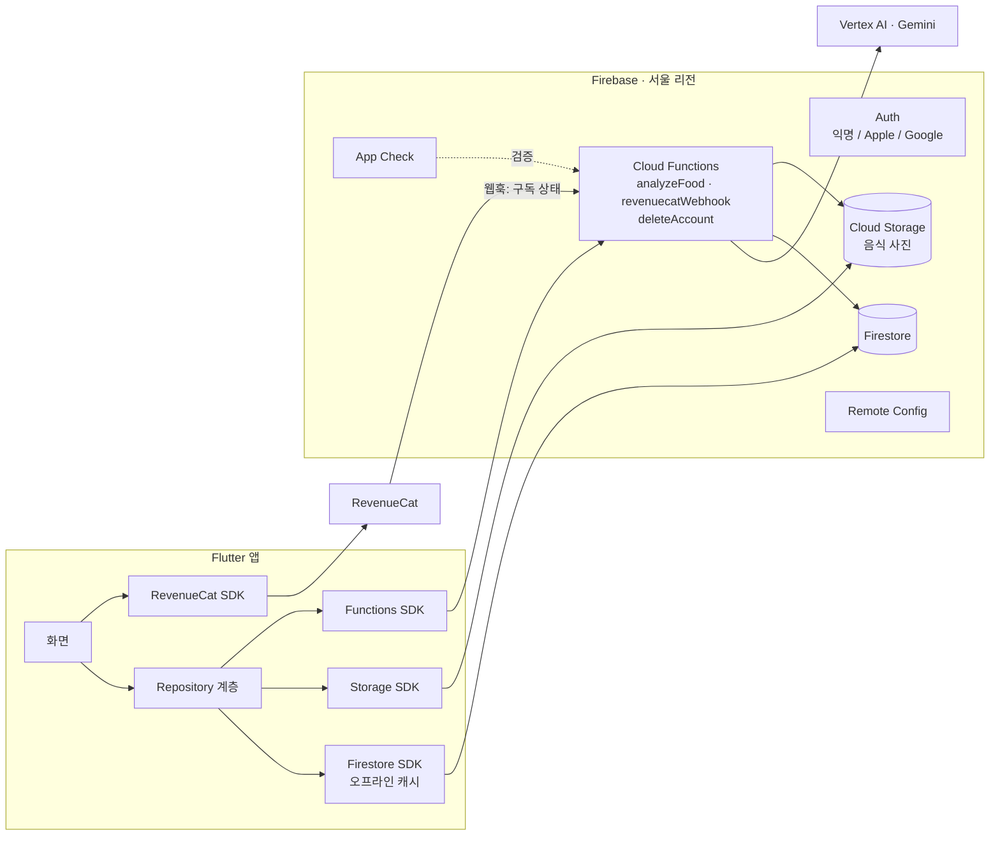
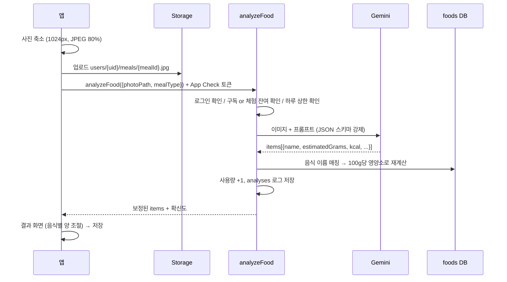

# 칼로리스냅(칼로리스냅) 정식 출시 설계서

> 문서 버전 v1.0 · 2026-11-09
> 목표: 개인 프로토타입을 **구독형 유료 앱**으로 iOS / Android 스토어에 정식 출시

> **변경 (2026-11-10): 로그인 없이 출시합니다.**
> - 로그인 화면, Apple/Google/카카오 로그인, 계정 삭제 기능은 만들지 않습니다.
> - 식단 기록은 기기에만 저장하고, 클라우드 동기화 대신 **백업 파일 저장/불러오기**를 넣습니다.
> - 서버는 AI 분석과 구독 확인에만 씁니다. 사용량을 세기 위해 사용자에게 보이지 않는 익명 ID만 받습니다.
> - AI는 유료 Gemini(Vertex AI)를 씁니다. 무료 등급은 사진이 구글 학습에 쓰일 수 있고 하루 한도가 낮아 쓰지 않습니다.
> - 아래 4~5장, 8장, 10장의 로그인·Firestore 동기화 관련 내용은 이 결정이 우선합니다. 최신 구조는 [ARCHITECTURE.md](ARCHITECTURE.md)를 보세요.

---

## 0. 한눈에 보기

| 항목 | 결정 |
|---|---|
| 제품 한 줄 정의 | 사진 한 장으로 끝나는 식단 기록. **한식도 정확하게** |
| 플랫폼 | iOS + Android (Flutter). 웹(PWA)은 v1에서 제외하고 랜딩 페이지만 운영 |
| 수익 모델 | 구독제 (월간 / 연간). 연간 플랜에 7일 무료 체험 |
| 가격 | 월 **₩5,900** / 연 **₩39,000** (월 환산 ₩3,250, 약 45% 할인) |
| 무료 사용자 | 수동 기록과 캘린더는 무료. AI 사진 분석은 **체험용 3회** |
| 백엔드 | Firebase (Auth, Firestore, Storage, Functions, App Check) |
| AI | Gemini (Vertex AI 경유, 서버에서만 호출). 모델은 Remote Config로 교체 가능 |
| 결제 | RevenueCat + App Store / Google Play 인앱 구독 |
| 핵심 차별점 | ① 한 상 차림을 음식별로 나눠 인식 ② 식약처 영양성분 DB로 보정 ③ 1인분 기준으로 바로 조절 |
| 출시 목표 | 착수 후 약 8~10주 (1인 개발 기준) |

---

## 1. 제품 정의

### 1.1 문제
- 식단 앱은 **기록이 귀찮아서** 3일 안에 그만두는 경우가 대부분이다.
- 해외 AI 칼로리 앱은 **한식에 약하다.** 찌개와 반찬 여러 개, 공유하는 냄비 요리, 국물 양을 잘 추정하지 못한다.
- 국내 앱은 대부분 검색 후 수동으로 입력하는 방식이라 느리다.

### 1.2 타깃 사용자
| 페르소나 | 설명 | 핵심 니즈 |
|---|---|---|
| **다이어트 직장인** (핵심) | 25~39세, 점심은 외식, 저녁은 배달 | 3초 기록, 남은 칼로리 확인 |
| 운동하는 사람 | 헬스, 단백질 관리 | 탄단지, 특히 단백질 목표 |
| 건강 관리 | 30~50대, 혈당·체중 관리 | 꾸준한 기록과 주간 추이 |

### 1.3 가치 제안
> **"찍으면 끝. 김치찌개도, 한 상 차림도."**

1. **빠름**: 촬영부터 저장까지 10초 이내
2. **정확함**: 한식 영양성분 DB로 보정하고, 음식별로 양을 조절
3. **꾸준함**: 끼니 알림, 연속 기록일, 주간 리포트

### 1.4 경쟁 포지셔닝
| | 칼로리스냅 | 해외 AI 칼로리 앱 | 국내 검색형 식단 앱 |
|---|---|---|---|
| 사진 인식 | ✅ | ✅ | △ (일부) |
| 한식 정확도 | ✅ DB 보정 | △ | ✅ (수동) |
| 기록 속도 | ✅ 10초 | ✅ | ✗ 검색 필요 |
| 한국어 UX와 가격 | ✅ | △ 영어 위주, 비쌈 | ✅ |

---

## 2. 비즈니스 모델 (BM)

### 2.1 플랜 구성

| | 무료 | **프리미엄** |
|---|---|---|
| 수동 기록 / 음식 검색 | ✅ | ✅ |
| 캘린더 / 오늘 요약 | ✅ | ✅ |
| AI 사진 분석 | 체험 **3회** (평생) | **무제한** (공정 사용 기준 하루 30회) |
| 음식별 분리 인식과 양 조절 | 체험 중에만 | ✅ |
| 주간 / 월간 리포트 | 이번 주 요약만 | ✅ 전체 기간과 추이 |
| 탄단지 상세와 목표 | 칼로리만 | ✅ |
| 체중 기록과 목표 도달 예측 | ✗ | ✅ |
| 클라우드 백업 / 기기 간 동기화 | ✅ (데이터 보호는 기본 제공) | ✅ |
| 데이터 내보내기 (CSV) | ✗ | ✅ |

> **백업은 무료로 제공한다.** "결제를 안 하면 기록이 사라진다"는 인상을 주면 신뢰가 떨어지고 리뷰가 나빠진다. 비용은 AI 분석에서 발생하므로 그 부분을 유료로 막는다.

### 2.2 가격과 상품 ID

| 상품 | 가격 | 체험 | 상품 ID (스토어 공통) |
|---|---|---|---|
| 연간 | ₩39,000 | **7일 무료** | `caloriesnap_premium_yearly` |
| 월간 | ₩5,900 | 없음 | `caloriesnap_premium_monthly` |
| 출시 기념 연간 (첫 1개월 한정) | 첫해 ₩29,000 | 7일 무료 | 연간 상품의 Intro Offer |

- RevenueCat의 entitlement 이름은 `premium` 하나로 통일한다.
- 페이월에서는 **연간을 기본 선택**하고 "월 3,250원"으로 환산해 보여준다.
- 가격 실험은 RevenueCat Offerings로 앱 업데이트 없이 진행한다. (예: 연 ₩39,000 vs ₩49,000)

### 2.3 페이월 노출 위치
1. **온보딩 마지막** (가장 중요): 개인 맞춤 목표를 보여준 직후 "7일 무료로 시작하기". 닫기 버튼으로 무료 플랜 진입 가능 (소프트 페이월)
2. **AI 분석 체험 3회 소진 시**: 촬영 버튼을 누르면 페이월 표시
3. **잠긴 기능 탭 시**: 리포트 상세, 체중 예측, CSV 내보내기
4. **체험 종료 2일 전 알림**: 스토어 정책상 고지 의무는 스토어가 처리하지만, 앱 안에서도 미리 안내해 환불 요청을 줄인다.

### 2.4 단위 경제성 (추정)

**AI 원가** (gemini-2.5-flash-lite 기준, 출시 전 최신 단가 재확인 필요)
- 입력: 이미지(1024px로 축소, 약 1,000토큰) + 프롬프트(약 1,000토큰) ≈ 2,000토큰
- 출력: 음식 목록 JSON ≈ 500토큰
- **1회 분석 ≈ ₩0.5~1**
- 하루 5회 쓰는 사용자 기준 월 150회 ≈ **₩150 이하**

**구독 1건당 순수익** (부가세 10% 제외, 스토어 수수료 15% 적용 가정*)

| 플랜 | 결제액 | 부가세 제외 | 수수료 후 | 월 환산 |
|---|---|---|---|---|
| 월간 | ₩5,900 | ₩5,364 | ₩4,559 | ₩4,559 |
| 연간 | ₩39,000 | ₩35,455 | ₩30,136 | ₩2,511 |

\* Apple 스몰 비즈니스 프로그램(연 매출 100만 달러 이하)과 Google Play 구독 수수료는 15%. Apple 스몰 비즈니스 프로그램은 **별도 신청이 필요**하다.

**고정비 (월)**
| 항목 | 비용 |
|---|---|
| Apple 개발자 계정 | $99/년 ≈ ₩11,000/월 |
| Google Play 개발자 계정 | $25 (1회) |
| Firebase (Blaze) | 초기에는 거의 ₩0, 사용자 1천 명 기준 수천 원 수준 |
| RevenueCat | 월 매출 $2,500까지 무료 |
| 도메인 / 랜딩 | ≈ ₩2,000 |

→ **유료 구독자 약 5명이면 고정비를 넘는다.** 원가 구조상 리스크는 낮고, 관건은 **획득과 유지**다.

### 2.5 핵심 지표 (KPI)

| 단계 | 지표 | 1차 목표 |
|---|---|---|
| 획득 | 설치 → 온보딩 완료 | 70% |
| 전환 | 페이월 노출 → 체험 시작 | 10~15% |
| 전환 | 체험 → 유료 | 35% 이상 |
| 활성 | 첫날 AI 분석 1회 이상 | 60% |
| 유지 | D7 리텐션 | 30% |
| 유지 | 월 구독 해지율 | 10% 이하 |
| 품질 | AI 결과 수정 비율 | 30% 이하 (낮을수록 정확) |
| 원가 | 활성 사용자 1인당 월 AI 비용 | ₩200 이하 |

### 2.6 성장 전략 (출시 후)
- **ASO**: 키워드는 "칼로리", "식단", "다이어트", "AI 칼로리", "음식 사진 칼로리", "탄단지"
- **콘텐츠**: 인스타그램 / 틱톡 숏폼 "배달 음식 칼로리 맞히기" 시리즈 (앱 화면 녹화)
- **친구 초대**: 초대한 사람과 받은 사람 모두 프리미엄 1주 (v1.1, RevenueCat Promotional Entitlement)
- **리뷰 요청**: 연속 기록 7일 달성 시점에 인앱 리뷰 요청

---

## 3. 기능 범위

### 3.1 v1.0 출시 필수 (MVP)
| 영역 | 기능 |
|---|---|
| 계정 | 익명으로 시작 → Apple / Google 로그인으로 계정 연결, 로그아웃, **계정 삭제** |
| 온보딩 | 목표(감량 / 유지 / 증량) → 신체 정보 → 활동량 → 목표 체중과 속도 → 맞춤 결과 → 알림 권한 → 페이월 |
| 촬영 / 분석 | 카메라·갤러리, **여러 음식 분리 인식**, 음식별 양 조절(0.5 / 1 / 1.5 / 2배, 직접 g 입력), 이름 수정 |
| 수동 기록 | 음식 검색(식약처 DB), 최근 / 자주 먹은 음식 |
| 오늘 | 남은 칼로리 링, 탄단지 바, 끼니별 카드 |
| 기록 | 월 캘린더(목표 대비 색 표시), 날짜별 상세 |
| 리포트 | 주간 평균, 목표 달성일 수, 탄단지 비율 |
| 구독 | 페이월, 구독 복원, 구독 관리 링크, 체험 횟수 표시 |
| 알림 | 끼니 시간 알림 (로컬 알림) |
| 데이터 | 클라우드 동기화, 오프라인 기록, 기존 로컬 데이터 이전 |
| 운영 | 오류 수집, 이벤트 분석, 강제 업데이트 안내 |
| 법무 | 개인정보처리방침, 이용약관, 민감정보 동의, AI 국외 이전 고지, 의료 면책 |

### 3.2 v1.1 (출시 후 1~2개월)
- 체중 기록과 목표 도달 예측 그래프
- Apple 건강 / Health Connect 연동 (걸음 수, 활동 칼로리 반영)
- 연속 기록일(스트릭)과 배지
- 홈 화면 위젯 (남은 칼로리)
- 카카오 로그인
- 친구 초대 보상

### 3.3 v1.2 이후
- 바코드 스캔 (가공식품)
- 물 섭취 기록
- 즐겨찾기 "나만의 식단" 한 번에 기록
- AI 코멘트 ("오늘 단백질이 부족해요. 저녁엔 닭가슴살 어때요?")
- 영어 지원 후 해외 출시

---

## 4. 시스템 아키텍처

### 4.1 전체 구성



### 4.2 기술 선택

| 영역 | 선택 | 이유 |
|---|---|---|
| 상태 관리 | **Riverpod** | 화면 상태와 데이터 계층 분리, 테스트 용이 |
| 라우팅 | **go_router** | 딥링크(알림 → 촬영 화면), 페이월 라우팅 |
| 로그인 | `firebase_auth`, `sign_in_with_apple`, `google_sign_in` | iOS는 다른 소셜 로그인을 넣으면 Apple 로그인 필수 |
| DB | `cloud_firestore` (오프라인 캐시 켜기) | 오프라인에서도 기록 가능, 자동 동기화 |
| 사진 | `firebase_storage` + `flutter_image_compress` | 업로드 전 1024px / JPEG 80%로 축소 |
| 서버 | Cloud Functions 2세대 (TypeScript, Node 22) | API 키 숨김, 구독·사용량 검증 |
| AI | Vertex AI `@google/genai` SDK | API 키 대신 서비스 계정 사용, 구조화된 JSON 출력 |
| 결제 | `purchases_flutter` (RevenueCat) | 두 스토어 구독을 한 번에 관리, 영수증 검증 대행 |
| 보안 | `firebase_app_check` (App Attest / Play Integrity) | 앱이 아닌 곳에서 서버 호출 차단 |
| 알림 | `flutter_local_notifications` | 끼니 알림은 로컬 알림으로 충분 |
| 운영 | Crashlytics, Analytics, Remote Config | 오류, 지표, 모델·가격 원격 변경 |
| 폰트 | Pretendard | 무료 상업 이용 가능(OFL), 한글 가독성 |

### 4.3 Flutter 폴더 구조

```
lib/
  main.dart
  app/
    router.dart            # go_router 라우트, 페이월·로그인 가드
    theme/                 # 디자인 토큰 (7장)
      tokens.dart
      app_theme.dart
  core/
    firebase/              # 초기화, App Check
    analytics/             # 이벤트 이름 상수
    utils/
  features/
    onboarding/
    auth/
    today/                 # 홈 (오늘)
    capture/               # 촬영 → 분석 → 결과
    log/                   # 캘린더 기록
    report/
    paywall/
    my/                    # 마이 페이지 / 설정
    food_search/
  data/
    models/                # Meal, MealItem, UserProfile, ...
    repositories/          # MealRepository, UserRepository, AnalysisRepository
  shared/widgets/          # 공용 컴포넌트 (7.6절)
functions/                 # Cloud Functions (TypeScript)
  src/
    analyzeFood.ts
    revenuecatWebhook.ts
    deleteAccount.ts
    foodDb/                # 식약처 DB 매칭
```

---

## 5. 데이터 설계 (Firestore)

```
users/{uid}
  profile: { sex, birthYear, heightCm, weightKg, activityLevel(0~3),
             goalType: 'lose'|'maintain'|'gain', targetWeightKg, weeklyRateKg }
  goals:   { kcal, carbsG, proteinG, fatG }
  settings:{ mealTimes: { breakfast:[6,10], lunch:[11,14], dinner:[17,21] },
             notifications: { breakfast:true, lunch:true, dinner:true },
             theme: 'system'|'light'|'dark' }
  entitlement: { premium: bool, productId, expiresAt, store, willRenew }   # 서버만 쓰기
  trial: { freeAnalysesUsed: int }                                         # 서버만 쓰기
  consents: { terms: ts, privacy: ts, sensitiveHealth: ts, overseasTransfer: ts }
  createdAt, updatedAt

users/{uid}/meals/{mealId}
  date: 'yyyy-MM-dd'           # 사용자 현지 날짜
  mealType: 'breakfast'|'lunch'|'dinner'|'snack'
  items: [{
    name, foodId?,             # foodId = 식약처 DB 매칭 결과
    grams, servings,           # 1인분 대비 배수
    kcal, carbsG, proteinG, fatG,
    source: 'ai'|'db'|'manual',
    confidence?: 'high'|'medium'|'low'
  }]
  totals: { kcal, carbsG, proteinG, fatG }   # items 합계 (조회 성능용)
  photoPath?                  # Storage 경로
  analysisId?                 # 어떤 AI 분석에서 왔는지
  edited: bool                # 사용자가 AI 결과를 고쳤는지 (품질 지표)
  createdAt, updatedAt

users/{uid}/usage/{yyyy-MM-dd}
  analyses: int               # 서버만 쓰기, 하루 상한 검사용

users/{uid}/weights/{yyyy-MM-dd}   # v1.1
  kg

analyses/{analysisId}         # 서버 전용, 품질 개선용 (90일 후 자동 삭제)
  uid, model, latencyMs, inputTokens, outputTokens, rawItems, createdAt

foods/{foodId}                # 식약처 식품영양성분 DB에서 가공
  name, aliases[], category,
  per100g: { kcal, carbsG, proteinG, fatG },
  servingG                    # 1인분 기준 중량
```

**Storage 경로**: `users/{uid}/meals/{mealId}.jpg`

**보안 규칙 원칙**
- `users/{uid}` 아래는 본인만 읽고 쓸 수 있다.
- `entitlement`, `trial`, `usage`는 **클라이언트 쓰기 금지** (Functions만 쓰기)
- `analyses`는 클라이언트 접근 불가, `foods`는 로그인 사용자 읽기 전용

**기존 데이터 이전**: 현재 기록은 기기의 `SharedPreferences`에 JSON으로 저장되어 있다 (`lib/services/database_service.dart`). 첫 로그인 시 이 데이터를 읽어 `meals`로 1회 업로드하고, 완료 플래그를 남긴다. 기존 기록은 음식 1개짜리 `items`로 변환한다.

---

## 6. AI 분석 파이프라인

### 6.1 흐름



### 6.2 출력 형식 변경
현재는 음식 1개만 돌려준다. **음식별 목록**으로 바꾼다.

```json
{
  "is_food": true,
  "items": [
    { "name": "김치찌개", "estimated_grams": 400, "kcal": 210,
      "carbs_g": 12, "protein_g": 14, "fat_g": 11, "confidence": "medium" },
    { "name": "쌀밥", "estimated_grams": 210, "kcal": 315,
      "carbs_g": 69, "protein_g": 6, "fat_g": 1, "confidence": "high" },
    { "name": "계란말이", "estimated_grams": 60, "kcal": 95,
      "carbs_g": 2, "protein_g": 7, "fat_g": 7, "confidence": "medium" }
  ],
  "shared_dish": false,
  "note": "1인분 기준"
}
```
- Gemini의 `responseSchema`로 형식을 강제해 지금의 "중괄호 찾기" 파싱을 없앤다.
- 1인분 판단 규칙(치킨 한 마리 → 1인분 등)은 현재 프롬프트(`lib/utils/prompt.dart`)를 유지·발전시킨다.
- 음식 이름은 **표준 한식 명칭**으로 답하게 해 DB 매칭률을 높인다.

### 6.3 식약처 DB 보정
1. 공공데이터포털 "식품의약품안전처 식품영양성분 DB"에서 음식(요리) 데이터를 받아 `foods`로 가공한다.
2. 자주 먹는 한식 300개는 별칭(`aliases`)을 직접 정리한다. (예: "김찌" → 김치찌개, "제육" → 제육볶음)
3. AI가 준 이름이 DB와 매칭되면: **DB의 100g당 영양소 × AI가 추정한 중량**으로 다시 계산한다. `source: 'db'`
4. 매칭되지 않으면 AI 추정값을 그대로 쓴다. `source: 'ai'`
5. 사용자가 고친 기록(`edited: true`)을 모아 별칭과 프롬프트를 계속 개선한다.

### 6.4 제한과 비용 관리
| 규칙 | 값 | 비고 |
|---|---|---|
| 무료 체험 | 평생 3회 | `users/{uid}.trial.freeAnalysesUsed` |
| 프리미엄 하루 상한 | 30회 | 초과 시 "내일 다시" 안내. Remote Config로 조정 |
| 분당 상한 | 5회 | 연타·스크립트 방지 |
| 타임아웃 | 20초 | 초과 시 재시도 버튼 |
| 모델 | `gemini-2.5-flash-lite` 기본 | Remote Config로 상위 모델 교체 가능 |
| 실패 시 | 사용량 차감 안 함 | 음식이 아닌 사진도 차감 안 함 |

---

## 7. 디자인 시스템

### 7.1 브랜드 방향
- **키워드**: 산뜻함, 가벼움, 믿음직함
- **톤**: 숫자는 크고 또렷하게, 나머지는 조용하게. 음식 사진이 주인공이다.
- **말투**: 친근한 해요체. 죄책감을 주지 않는다.
  - ✗ "목표 칼로리를 초과했습니다"
  - ✓ "오늘은 320kcal 더 드셨어요. 내일 가볍게 맞춰봐요"

### 7.2 컬러 토큰
현재의 Material 기본 초록(`#4CAF50`)을 더 맑고 선명한 초록으로 다듬고, 다크 모드를 정식으로 지원한다.

| 토큰 | 라이트 | 다크 | 용도 |
|---|---|---|---|
| `brand` | `#12B76A` | `#32D583` | 주요 버튼, 링, 선택 상태 |
| `brandPressed` | `#039855` | `#6CE9A6` | 눌림 상태 |
| `brandSubtle` | `#ECFDF3` | `#0B2E1F` | 칩 배경, 강조 영역 |
| `bg` | `#F7F8FA` | `#0E0F11` | 화면 배경 |
| `surface` | `#FFFFFF` | `#17191C` | 카드, 시트 |
| `surfaceAlt` | `#F1F3F5` | `#202327` | 입력창, 보조 카드 |
| `border` | `#E5E7EB` | `#2A2D31` | 카드 테두리, 구분선 |
| `text1` | `#111827` | `#F3F4F6` | 제목, 숫자 |
| `text2` | `#6B7280` | `#9CA3AF` | 본문 보조 |
| `text3` | `#9CA3AF` | `#6B7280` | 힌트, 비활성 |
| `carbs` | `#3B82F6` | `#60A5FA` | 탄수화물 |
| `protein` | `#F43F5E` | `#FB7185` | 단백질 |
| `fat` | `#F59E0B` | `#FBBF24` | 지방 |
| `over` | `#EF4444` | `#F87171` | 목표 초과 |
| `premium` | `#7C3AED` → `#12B76A` 그라데이션 | 동일 | 프리미엄 배지, 페이월 강조 |

**캘린더 날짜 색**: 기록 없음 = 무색 / 목표의 90~110% = `brand` / 110% 초과 = `over` / 90% 미만 = `brandSubtle`

### 7.3 타이포그래피 (Pretendard)

| 스타일 | 크기 / 굵기 / 줄간격 | 용도 |
|---|---|---|
| `display` | 40 / 800 / 1.1, 숫자 고정폭 | 남은 칼로리 큰 숫자 |
| `title1` | 24 / 700 / 1.3 | 화면 제목 |
| `title2` | 20 / 700 / 1.35 | 섹션 제목, 시트 제목 |
| `headline` | 17 / 600 / 1.4 | 카드 제목, 음식 이름 |
| `body` | 15 / 400 / 1.5 | 본문 |
| `label` | 14 / 600 / 1.3 | 버튼, 탭 |
| `caption` | 13 / 500 / 1.4 | 보조 정보, 단위 |
| `micro` | 11 / 600 / 1.2 | 배지, 그래프 축 |

숫자에는 `FontFeature.tabularFigures()`를 적용해 값이 바뀌어도 폭이 흔들리지 않게 한다.

### 7.4 간격 · 모서리 · 그림자 · 모션
- **간격 (4pt 단위)**: 4 / 8 / 12 / 16 / 20 / 24 / 32 / 48. 화면 좌우 여백 20
- **모서리**: 칩 8 / 버튼·입력 12 / 카드 16 / 바텀시트 24 / 음식 사진 썸네일 12
- **그림자**: 기본은 그림자 없이 테두리만. 바텀시트와 촬영 버튼에만 부드러운 그림자 (`0 8 24 rgba(0,0,0,.08)`)
- **모션**: 기본 200ms ease-out / 칼로리 링 채우기 700ms / 화면 전환 300ms
- **햅틱**: 촬영 시 medium, 저장 완료 시 success, 목표 달성 시 success 2회

### 7.5 정보 구조 (하단 탭)

현재: 캘린더 / 통계 / 촬영 / 설정 → 변경:

```
┌──────┬──────┬──────────┬──────┬──────┐
│ 오늘 │ 기록 │  ( 📷 )  │리포트│  MY  │
└──────┴──────┴──────────┴──────┴──────┘
                 ↑ 가운데 큰 원형 촬영 버튼 (brand, 56px)
```
- **오늘**: 앱을 열면 처음 보는 화면. "지금 얼마나 남았지?"에 바로 답한다.
- **촬영**: 탭이 아니라 **동작 버튼**이다. 누르면 전체 화면 카메라가 뜬다. 길게 누르면 갤러리/수동 입력 메뉴.

### 7.6 공용 컴포넌트
| 컴포넌트 | 설명 |
|---|---|
| `CalorieRing` | 남은 칼로리 원형 게이지. 가운데 `display` 숫자 + "남음" / 초과 시 `over` 색과 "초과" |
| `MacroBar` | 탄·단·지 가로 막대 3개, 현재/목표 g 표시 |
| `MealSection` | 끼니 제목 + 합계 kcal + 음식 카드 목록 + "추가" 버튼 |
| `FoodItemTile` | 썸네일 · 이름 · 양 · kcal. 탭하면 수정 시트 |
| `PortionStepper` | 0.5 / 1 / 1.5 / 2 인분 칩 + 직접 g 입력 |
| `ConfidenceBadge` | AI 확신도 (높음/보통/낮음). 낮음이면 "확인해 주세요" |
| `PremiumBadge` | 잠긴 기능 옆 작은 배지, 탭하면 페이월 |
| `EmptyState` | 일러스트 + 한 줄 안내 + 버튼 |
| `PrimaryButton` | 높이 56, 모서리 12, 전체 폭, 로딩 상태 포함 |

### 7.7 화면 설계

#### ① 오늘 (홈)
```
11월 9일 (월)                    🔥 5일 연속
┌─────────────────────────────────────┐
│           ╭───────────╮             │
│          │    820     │  ← display   │
│          │  kcal 남음  │             │
│           ╰───────────╯             │
│   먹은 양 1,180   ·   목표 2,000     │
│  탄 ▓▓▓▓▓░░ 142/250g                │
│  단 ▓▓▓░░░░  48/110g                │
│  지 ▓▓▓▓░░░  31/55g                 │
└─────────────────────────────────────┘
아침 ☀️                         420 kcal
 [🖼] 그릭요거트 · 1컵            180
 [🖼] 바나나 · 1개                 95
점심                            760 kcal
 [🖼] 김치찌개 정식 · 3개 음식     760
저녁                               +
 기록하기  ← 점선 카드
```

#### ② 촬영 → 분석 → 결과
1. **촬영**: 전체 화면 카메라, 가운데 가이드 프레임, 하단 "갤러리 · 촬영 · 직접 입력". 무료 사용자는 상단에 "무료 분석 2회 남음"
2. **분석 중** (2~5초): 찍은 사진 위에 스캔 애니메이션 + 바뀌는 문구 ("반찬을 세고 있어요", "양을 재고 있어요")
3. **결과** (바텀시트가 위로 올라옴):
```
[ 찍은 사진 ]
점심 ▾                       총 620 kcal
─────────────────────────────────────
김치찌개      1인분(400g)       210  ⓘ
  [0.5] [ 1 ] [1.5] [ 2 ]  직접입력
쌀밥          1공기(210g)       315
계란말이       2조각(60g)        95  보통
+ 음식 추가
─────────────────────────────────────
탄 83g · 단 27g · 지 19g
[            저장하기            ]
```
- 음식 이름을 탭하면 이름 수정 + DB 검색
- 확신도가 낮은 음식은 노란 배지로 "확인해 주세요"
- 저장 후 오늘 화면으로 돌아가며 칼로리 링이 다시 채워지는 애니메이션

#### ③ 기록 (캘린더)
- 월 캘린더, 날짜 아래 작은 점 색으로 목표 대비 상태 표시 (7.2절)
- 날짜를 탭하면 바텀시트로 그날 상세 (현재 구현된 방식 유지)

#### ④ 리포트
- 무료: 이번 주 평균 칼로리, 기록일 수
- 프리미엄: 주/월 전환, 일별 막대 그래프 + 목표선, 탄단지 비율 도넛, 자주 먹은 음식 TOP 5, 체중 추이(v1.1)
- 잠긴 영역은 흐리게 보여주고 그 위에 "프리미엄으로 전체 보기" 버튼

#### ⑤ MY
```
프로필 카드 (목표 2,000kcal · 감량 중)    [수정]
프리미엄 카드: 연간 이용 중 · 2027.11.09 갱신  [관리]
───
목표 설정 / 끼니 시간과 알림 / 화면 테마
계정 (Apple로 로그인됨) / 데이터 내보내기
───
도움말 · 문의 / 개인정보처리방침 / 이용약관 / 오픈소스 라이선스
로그아웃 / 계정 삭제
```
- 현재 설정 화면의 **Gemini API 키 입력과 AI 모델 항목은 삭제**한다.

#### ⑥ 온보딩 (8단계, 진행 막대 표시)
1. 환영: "찍으면 끝. 한식도 정확하게" + 시작하기
2. 목표: 감량 / 유지 / 증량
3. 신체 정보: 성별, 나이, 키, 몸무게
4. 활동량: 4단계 (예시 문구와 함께)
5. 목표 체중과 속도: 주 0.25 / 0.5 / 0.75kg
6. **맞춤 결과**: "하루 1,850kcal 드시면 **2027년 2월 14일**에 목표 체중에 도달해요" + 탄단지 목표
7. 알림 권한: "끼니 시간에 알려드릴까요?"
8. **페이월**

> 칼로리 계산은 현재 Harris-Benedict 공식에서 **Mifflin-St Jeor** 공식으로 바꾼다 (현대 기준에서 더 정확). 감량 시 하루 최소 칼로리 하한(여성 1,200 / 남성 1,500)을 둔다.

#### ⑦ 페이월
```
                                        ✕ (3초 후 표시)
     ✨ 칼로리스냅 프리미엄
  목표까지 더 빠르고 정확하게

  ✓ AI 사진 분석 무제한
  ✓ 한 상 차림도 음식별로 인식
  ✓ 주간·월간 리포트와 체중 예측
  ✓ 탄단지 상세 목표

  ┌────────────────────────────┐
  │ ● 연간   ₩39,000   45% 할인 │ ← 기본 선택, brand 테두리
  │   월 3,250원 · 7일 무료 체험 │
  └────────────────────────────┘
  ┌────────────────────────────┐
  │ ○ 월간   ₩5,900            │
  └────────────────────────────┘

  [     7일 무료로 시작하기     ]
  체험 중 언제든 해지하면 요금이 청구되지 않아요
  구매 복원 · 이용약관 · 개인정보처리방침
```
- 체험 타임라인을 함께 보여준다: "오늘 시작 → 5일차 알림 → 7일차 결제"
- 스토어 심사 요건: 가격, 결제 주기, 자동 갱신 고지, 약관 링크, 구매 복원 버튼 필수

### 7.8 앱 아이콘과 스토어 그래픽
- **아이콘**: brand 초록 배경 위에 흰색 카메라 셔터와 숟가락을 합친 형태. 글자 없이 단순하게
- **스토어 스크린샷 5장**:
  1. "찍으면 끝" — 촬영 화면
  2. "한 상 차림도 음식별로" — 결과 화면 (김치찌개 정식)
  3. "남은 칼로리 한눈에" — 오늘 화면
  4. "목표 도달일까지 예측" — 온보딩 결과
  5. "한 달 기록을 캘린더로" — 기록 화면

### 7.9 접근성
- 텍스트 대비 4.5:1 이상 (토큰 기준 충족)
- 시스템 글자 크기 확대 시 레이아웃이 깨지지 않게 1.3배까지 확인
- 탄단지는 색에만 의존하지 않고 글자(탄/단/지)를 함께 표시
- 터치 영역 최소 44×44

---

## 8. 보안 · 개인정보 · 법무

### 8.1 보안
- Gemini 호출은 **서버에서만**. 앱에는 어떤 API 키도 넣지 않는다.
- App Check 강제 적용 (Functions, Firestore, Storage)
- 구독 상태는 RevenueCat 웹훅 → Functions → Firestore로만 갱신. 앱이 보낸 값을 믿지 않는다.
- 웹훅은 Authorization 헤더 비밀값으로 검증한다.

### 8.2 개인정보 (국내법 기준, 전문가 검토 권장)
| 항목 | 처리 방식 |
|---|---|
| 수집 항목 | 성별, 출생연도, 키, 몸무게, 식단 기록, 음식 사진, 로그인 식별자 |
| **민감정보** | 체중·식단 등 건강 관련 정보는 민감정보에 해당할 수 있으므로 **별도 동의**를 받는다 (온보딩 신체 정보 입력 직전) |
| **국외 이전** | 사진이 AI 분석을 위해 Google 서버로 전송될 수 있음을 고지하고 동의받는다 (서울 리전 사용이 가능하면 우선 사용) |
| 사진 보관 | 사용자 기록의 썸네일 용도로 보관. 기록 삭제 시 즉시 삭제 |
| 분석 로그 | 품질 개선용, 90일 후 자동 삭제. 사진 원본은 포함하지 않음 |
| 계정 삭제 | 앱 안에서 즉시 삭제 (Firestore, Storage, Auth, RevenueCat 고객 정보) |
| AI 학습 | 사용자 사진을 모델 학습에 쓰지 않는다 (Vertex AI 기본 정책 확인) |

### 8.3 출시 전 법무 · 행정 체크리스트
- [ ] 사업자등록 (개인사업자, 업종: 응용 소프트웨어 개발 및 공급)
- [ ] 통신판매업 신고 필요 여부 확인 (앱마켓만 통해 판매할 때의 기준은 세무사·관할 구청에 확인)
- [ ] 개인정보처리방침 / 이용약관 / 구독 약관 작성 후 웹에 게시 (랜딩 페이지)
- [ ] 의료 면책 문구: "칼로리스냅의 영양 정보는 추정치이며 의학적 조언을 대신하지 않습니다"
- [ ] Apple 스몰 비즈니스 프로그램 신청
- [ ] App Store: 개인정보 라벨, 연령 등급, 구독 그룹 설정, 심사용 메모와 데모 계정
- [ ] Google Play: 데이터 보안 양식, 건강 앱 신고, 결제 프로필
- [ ] 정산 계좌와 세금 정보 등록 (두 스토어)

---

## 9. 분석 이벤트

| 이벤트 | 속성 |
|---|---|
| `onboarding_step` | step, value |
| `onboarding_complete` | goalType, kcalGoal |
| `paywall_view` | source (onboarding / limit / feature), offering |
| `trial_start` / `purchase` | productId, price |
| `restore_purchase` | success |
| `capture_start` | method (camera / gallery) |
| `analysis_success` | itemCount, latencyMs, dbMatchRate |
| `analysis_fail` | reason (not_food / timeout / limit / error) |
| `meal_save` | itemCount, edited, source |
| `meal_edit` | field (portion / name / kcal) |
| `notification_open` | mealType |
| `report_view` | period, locked |

---

## 10. 로드맵 (1인 개발 기준 약 8~10주)

| 단계 | 기간 | 작업 | 완료 기준 |
|---|---|---|---|
| **0. 기반 정리** | 1주 | 폴더 구조 재편, Riverpod·go_router 도입, 디자인 토큰과 Pretendard 적용, Firebase 프로젝트 생성 (dev / prod 분리) | 기존 기능이 새 구조에서 그대로 동작 |
| **1. 계정과 데이터** | 1.5주 | 익명 로그인 → Apple/Google 연결, Firestore 저장으로 전환, 오프라인 캐시, 기존 로컬 데이터 이전 | 앱 재설치 후 로그인하면 기록 복원 |
| **2. AI 서버** | 2주 | `analyzeFood` 함수, 여러 음식 인식, 결과 화면 개편(양 조절), 식약처 DB 가공과 매칭, 사용량 제한, App Check | API 키 입력 없이 분석 동작, 한식 테스트 사진 50장 검증 |
| **3. 구독** | 1.5주 | RevenueCat 연동, 웹훅, 페이월, 체험 횟수, 잠금 처리, 구매 복원 | 샌드박스에서 체험 → 결제 → 해지 → 만료까지 확인 |
| **4. 화면 완성** | 2주 | 오늘 / 기록 / 리포트 / MY / 온보딩 새 디자인, 다크 모드, 끼니 알림, 계정 삭제 | 7장 설계대로 전 화면 구현 |
| **5. 출시 준비** | 1~2주 | 오류 수집, 이벤트, 법무 문서, 스토어 그래픽, 내부 테스트(TestFlight / 비공개 테스트), 심사 제출 | 두 스토어 심사 통과 |

**AI 정확도 검증 방법**: 자주 먹는 한식·배달 음식 사진 50장을 모으고, 실제 칼로리와 비교해 오차 ±20% 이내 비율을 측정한다. 프롬프트나 모델을 바꿀 때마다 같은 세트로 다시 측정한다.

---

## 11. 현재 코드 → 변경 사항

| 현재 | 변경 |
|---|---|
| `lib/services/gemini_service.dart`: 앱에서 직접 Gemini 호출 | 삭제 → `AnalysisRepository`가 Cloud Function 호출 |
| `lib/services/prefs_service.dart`: API 키 저장 | API 키 관련 코드 삭제. 목표·설정은 Firestore `users/{uid}`로 이동 (기기 전용 값만 로컬 유지) |
| `lib/services/database_service.dart`: SharedPreferences JSON | `MealRepository` (Firestore) + 1회 데이터 이전 |
| `lib/models/analysis_result.dart`: 음식 1개 | `AnalysisResult { items: List<MealItem> }` |
| `lib/models/food_record.dart`: 음식 1개 기록 | `Meal { items, totals }` |
| `lib/utils/prompt.dart` | 서버(`functions/`)로 이동, 음식별 목록 형식 + 응답 스키마 |
| `lib/utils/constants.dart` `AppColors` | `app/theme/tokens.dart` 라이트/다크 토큰 |
| `lib/app.dart` 탭 4개 | go_router + 오늘 / 기록 / 촬영 버튼 / 리포트 / MY |
| `lib/screens/onboarding_screen.dart` Harris-Benedict | Mifflin-St Jeor + 목표 도달일 + 페이월 연결 |
| `lib/screens/settings_screen.dart` | MY 화면으로 개편, API 키·모델 항목 삭제 |
| `pubspec.yaml`의 `sqflite`, `sqflite_common_ffi_web` | 현재 사용하지 않으므로 제거 |
| `web/` PWA | v1에서 빌드 대상 제외 (랜딩 페이지는 별도) |

---

## 12. 남은 결정 사항

| 질문 | 기본안 | 결정 시점 |
|---|---|---|
| 앱 공식 이름 | **칼로리스냅**으로 확정 (2026-11-10). 한국어 앱은 검색되지 않음. 영어 "CalorieSnap"은 App Store에 같은 이름의 앱이 있어 영어 이름은 따로 정해야 함. 상표 출원 전 KIPRIS 검색 필요 | 출시 전 |
| 랜딩 페이지 도메인 | caloriesnap.kr 등 확인 | 출시 전 |
| 연간 가격 ₩39,000 vs ₩49,000 | ₩39,000으로 시작 후 실험 | 출시 후 1개월 |
| 카카오 로그인 v1 포함 여부 | v1.1로 미룸 | 단계 1 |
| 상위 AI 모델 사용 여부 | 정확도 측정 결과로 결정 | 단계 2 |
